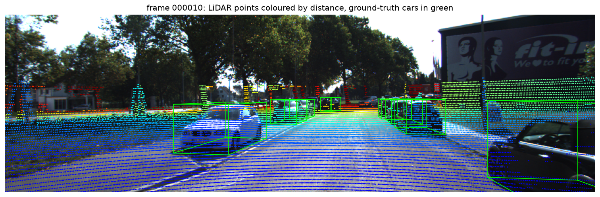

# Camera + LiDAR late fusion for 3D car detection (KITTI)

A LiDAR 3D detector (PointPillars, pretrained, via OpenPCDet) and a camera 2D
detector (YOLO11s, COCO-pretrained), combined by **late fusion**: each LiDAR 3D
box is projected into the camera image using the KITTI calibration, matched to
camera boxes by 2D IoU, and re-scored. The projection, fusion, evaluation
analysis and latency profiling are my own code; the two detectors use public
pretrained weights.

**Result:** the projection reproduces OpenPCDet's to **0.06 px** over 63,747
boxes. Score-level fusion did **not** improve overall accuracy over a strong
LiDAR detector: it gained up to +0.9 AP on easy cars and lost 0.9 to 1.7 AP on
hard (occluded, distant) ones. The full pipeline runs at about **22 ms per
frame** (about 45 FPS) on one A100 with both detectors in parallel, and the
bottleneck is point-cloud I/O and NMS, not network compute.

## Accuracy (KITTI val, 3,769 frames, Car, 3D AP R40)

| | Easy | Moderate | Hard | BEV moderate |
|---|---|---|---|---|
| LiDAR only (PointPillars) | 87.78 | 78.42 | 75.20 | 88.08 |
| Fused, IoU 0.5, penalty 0.3 | 88.20 | 78.30 | 74.20 | 88.01 |
| Fused, IoU 0.5, penalty 0.5 | 88.21 | 78.35 | 74.24 | 88.01 |
| **Fused, IoU 0.5, penalty 0.7** (best moderate) | 88.22 | 78.42 | 74.30 | 88.02 |
| Fused, IoU 0.7, penalty 0.5 | 88.72 | 78.24 | 73.53 | 87.93 |

Evaluated with OpenPCDet's implementation of the official KITTI metric. The two
fusion thresholds were tuned on this same validation split, so the fused
numbers are, if anything, slightly optimistic.

Confident detections (score >= 0.5) more than 2 m from any annotated object:

| | 0-30 m | Beyond 30 m |
|---|---|---|
| LiDAR only | 476 | 955 |
| Fused, IoU 0.5, penalty 0.7 | 605 | 2,360 |
| Fused, IoU 0.7, penalty 0.5 | 156 | 880 |



## Latency (one NVIDIA A100 40 GB, batch size 1, mean of 200 frames)

| Stage | FP32 (ms) | FP16 (ms) |
|---|---|---|
| Load point cloud + build pillars (CPU) | 10.9* | 10.9 |
| Copy to GPU | 1.0 | 1.0 |
| Pillar feature net (PillarVFE) | 0.9 | 0.8 |
| Scatter to bird's-eye-view grid | 0.5 | 0.4 |
| 2D backbone (BaseBEVBackbone) | 3.9 | 3.2 |
| Detection head | 0.9 | 0.9 |
| NMS (post-processing) | 2.9 | 2.9 |
| **LiDAR path total** | **20.9** | **20.0** |
| Camera path: YOLO11s, FP16 (pre / inference / post) | 18.6 (8.0 / 5.9 / 4.7) | |
| Fusion (CPU, NumPy) | 1.4 | |
| **End to end, detectors in parallel** | **22.3** | **21.5** |
| End to end, sequential | 40.9 | 40.0 |

\* The FP32 pass ran first and measured 106.9 ms for this stage: reading each
point cloud from network storage for the first time. The FP16 pass read the
same frames from the page cache. 10.9 ms is the steady-state cost, used in
both columns.

KITTI's LiDAR spins at 10 Hz (100 ms per scan), so either arrangement is well
inside real time.

## What I found

**Fusion helped where the camera is reliable and hurt where it isn't.** Easy
cars (large, unoccluded, near) gained 0.4 to 0.9 AP: the camera confirms them
and their scores rise above competing false positives. Hard cars lost 0.9 to
1.7 AP: these are heavily occluded or truncated, YOLO often misses them or
boxes only the visible part, so they fail to match and get down-weighted. A
stricter match (IoU 0.7) makes both effects larger. Moderate AP, the main
KITTI metric, is unchanged at best (78.42 vs 78.42).

**The detector is already strong, which limits late fusion.** PointPillars
reaches 88.1 BEV AP on its own; most of its remaining errors are hard cases
the camera can't resolve either. Score-level fusion can only re-rank boxes the
LiDAR already proposed; it can't recover a car the LiDAR missed or fix a box
that's placed wrong.

**False positives at a fixed threshold are a misleading comparison.** The
fusion rule `1 - (1 - s_lidar)(1 - s_camera)` raises every matched score, so
many weak LiDAR boxes cross the 0.5 threshold after fusion. That inflates the
fused counts at IoU 0.5 (especially beyond 30 m, where small boxes match
loosely), while the stricter IoU 0.7 setting cuts confident false positives by
two-thirds within 30 m. A fair comparison needs counts at equal recall, not
equal score; that's the next thing I'd measure.

**Compute is not the bottleneck.** The PointPillars network itself takes about
6 ms; FP16 saved only 9% of the GPU time because the network is small and NMS
(2.9 ms) runs in FP32 regardless. Reading and pillarizing the point cloud on
the CPU (10.9 ms, or 107 ms from cold network storage) and YOLO's image
pre/post-processing dominate. The next speed-ups would be pillarizing on the
GPU and overlapping I/O with compute, not a smaller model.

## Method

**Projection.** A LiDAR point reaches a pixel through the KITTI calibration
matrices, `P2 @ R0_rect @ Tr_velo_to_cam @ [x y z 1]`, followed by division by
depth. For a 3D box I project its 8 corners and take the tightest 2D rectangle.
Checked against OpenPCDet's own projection: mean difference 0.06 px over
63,747 boxes.

**Fusion.** For each LiDAR box, find the YOLO car box (COCO class 2,
confidence >= 0.1) with the highest 2D IoU.

- Match (IoU >= threshold): `score = 1 - (1 - s_lidar)(1 - s_camera)`, the
  probability that not both detectors are wrong.
- No match, and the projected box is at least 25 px tall: `score = s_lidar x penalty`.
- No match and smaller: unchanged, because the camera often misses small cars.

**Evaluation.** OpenPCDet's KITTI evaluation computes rotated-box overlaps with
numba's CUDA support, which crashes on current NVIDIA drivers. I replaced that
one function with OpenPCDet's own compiled CUDA overlap op, verified against
the original geometry (max difference about 1e-6) and with a runtime self-check
before every evaluation.

**Latency.** Each stage is timed separately with `torch.cuda.synchronize()`
around it, after 20 warm-up frames, one frame at a time.

## Reproduce

Requires the KITTI 3D object data and OpenPCDet (Python 3.10, PyTorch 2.1,
CUDA 11.8) with the pretrained PointPillars checkpoint.

```bash
# camera detections (PyTorch 2.x + ultralytics)
python run_yolo.py --kitti_root KITTI --split_file OpenPCDet/data/kitti/ImageSets/val.txt
# LiDAR detections, from OpenPCDet/tools
python test.py --cfg_file cfgs/kitti_models/pointpillar.yaml --ckpt ../checkpoints/pointpillar_7728.pth
# fusion and evaluation
python fuse_eval.py --result result.pkl --yolo results/yolo_val.json \
    --infos OpenPCDet/data/kitti/kitti_infos_val.pkl --penalty 0.7
# latency
python latency.py --openpcdet OpenPCDet --ckpt OpenPCDet/checkpoints/pointpillar_7728.pth
```

## Files

- [`kitti_utils.py`](kitti_utils.py): calibration, point-cloud and label reading, projection, IoU
- [`visualize.py`](visualize.py): LiDAR points and 3D boxes drawn on the camera image
- [`run_yolo.py`](run_yolo.py): camera detections for every validation image
- [`fuse_eval.py`](fuse_eval.py): late fusion, official KITTI AP, false positives by distance
- [`latency.py`](latency.py): per-stage PointPillars latency, FP32 vs FP16
- [`jobs/`](jobs/): Slurm job scripts (TAMU HPRC Grace)
- [`results/`](results/): all numbers in this README
